<div align="center">

# 🐾 AetherPet (艾瑟灵宠)

**前后端一体 · 开源 3D AI 宠物伴侣框架 (Multi-LLM + Multi-TTS + WebGL/Three.js)**

[](./LICENSE)
[](https://nextjs.org/)
[](https://threejs.org/)
[](#)
[](#)

</div>

---

## ✨ 项目亮点 (Features)

**AetherPet** 是一个开箱即用、前后端一体化的开源 **3D AI 宠物与数字伴侣开发框架**。只需一个仓库、`npm run dev` 一条命令，即可拥有具备**灵魂对话、多源配音、实时声波口型同步 (Lip-Sync)、果冻物理触摸反馈**的 3D AI 萌宠。

1. 🧠 **全生态大模型网关 (`/api/chat`)**
   - 原生支持 **DeepSeek** (`deepseek-chat` / `deepseek-reasoner`)、**OpenAI** (`gpt-4o-mini` / `gpt-4o`)、**硅基流动 (SiliconFlow)**、**通义千问 (DashScope)**、**智谱 GLM**、**本地 Ollama** 以及任意 **OneAPI / OpenAI 兼容接口**。
   - 支持 **SSE 流式输出** 与 **零配置智能回退模式**（不填任何 Key 也能立即体验完整 3D 情绪、动作与语音对话）。
2. 🎙️ **多源配音合成 + WebAudio 实时口型驱动 (`/api/tts` + `VoiceEngine`)**
   - **免 Key 开箱即用**：内置免费云端语音与浏览器原生 `Web Speech API` 双重免配置发音方案。
   - **专业配音 API 接入**：一键对接 **SiliconFlow (CosyVoice2 / FishSpeech)**、**OpenAI TTS (`nova`/`shimmer`)**、**Fish Audio (二次元角色声线)**、**ElevenLabs** 以及本地 **GPT-SoVITS / CosyVoice**。
   - **实时频谱口型同步**：基于 `AudioContext + AnalyserNode` 实时提取人声频段能量包络，驱动 3D 宠物张嘴幅度与脚下声波光环。
3. 🎨 **高表现力 3D 交互引擎 (Three.js + React Three Fiber + VRM)**
   - **内置 3 种程序化 3D 萌宠形态**：`星光糯米团 (Mochi)`、`霓虹灵狐 (CyberFox)`、`星际喵灵 (AstraCat)`，搭配 5 套星云舞台配色。
   - **胡克定律果冻弹性物理**：点击摸头、戳脸颊、揉肚子均会触发真实的果冻挤压回弹 (Squash & Stretch) 与 3D 爆裂爱心/星光粒子。
   - **支持自定义 `.vrm` / `.glb` / `.gltf` 外部模型导入**：直接上传 VRoid 导出的 `.vrm` 虚拟形象，自动绑定 `aa` 口型同步与头部视线追踪。
4. 🎭 **大模型情绪与 3D 动作协同协议 (`[EMOTION:xxx|ACTION:yyy]`)**
   - 大模型在回复时自动输出情绪（`happy` / `excited` / `curious` / `shy` / `sleepy` / `thinking` / `sad` / `love`）与 3D 动作指令（`jump` / `spin` / `wave` / `nod` / `dance` / `shake`），实现「边说边跳、害羞脸红、开心转圈」的生命感。

---

## 🏗️ 架构总览 (Architecture)

```mermaid
flowchart LR
    User["👤 用户 (触摸 / 文字 / 麦克风 ASR)"] --> HUD["🖥️ Next.js 前端 (PetHUD + PetStage)"]
    HUD -->|SSE 流式对话| ChatAPI["⚡ /api/chat (多模型统一网关)"]
    ChatAPI --> LLM["🧠 DeepSeek / OpenAI / SiliconFlow / Qwen / Ollama"]
    LLM -->|"[EMOTION:excited|ACTION:jump] 回复文本"| Parser["🎭 情绪与动作解析器"]
    Parser --> Stage3D["🐾 Three.js / R3F 3D 舞台 & VRM 骨骼驱动"]
    Parser --> TTSAPI["🔊 /api/tts (多源配音网关)"]
    TTSAPI --> TTSProviders["🎙️ Edge免Key / CosyVoice2 / OpenAI / FishAudio / ElevenLabs"]
    TTSProviders -->|Audio Stream + AnalyserNode| LipSync["👄 实时声波频谱口型同步"]
    LipSync --> Stage3D
```



---

## 🚀 快速开始 (Quick Start)

### 1. 克隆并安装依赖

```bash
git clone https://github.com/FanDuck/AetherPet.git
cd AetherPet
npm install --legacy-peer-deps
```

### 2. 启动开发服务器

```bash
npm run dev
```

打开浏览器访问 **[http://localhost:3000](http://localhost:3000)** 即可开始互动！

> 💡 **零配置说明**：即使还没有配置 `.env` 文件，直接打开网页也能立即点击 3D 宠物摸头、投喂、听它开口说话。你随时可以点击网页右上角 **「引擎配置」** 按钮，在可视化面板中填入你的 **DeepSeek** 或 **OpenAI** API Key，配置会自动持久化保存在浏览器本地。

### 3. 服务端环境变量配置（可选，适合部署公开站点）

复制 `.env.example` 为 `.env.local`：

```bash
cp .env.example .env.local
```

编辑 `.env.local` 填入默认密钥：

```env
LLM_API_KEY=sk-your-deepseek-or-openai-key
LLM_BASE_URL=https://api.deepseek.com/v1
LLM_MODEL=deepseek-chat
```

---

## 🧩 核心目录结构

```text
aetherpet/
├── src/
│   ├── app/
│   │   ├── api/
│   │   │   ├── chat/route.ts         # 统一大模型 SSE 流式网关 (DeepSeek/OpenAI/Ollama等)
│   │   │   └── tts/route.ts          # 统一配音合成网关 (Edge/CosyVoice2/OpenAI/FishAudio/ElevenLabs)
│   │   ├── globals.css               # 全局样式
│   │   ├── layout.tsx                # 根布局
│   │   └── page.tsx                  # 全栈一体主视图
│   ├── components/
│   │   ├── canvas/
│   │   │   ├── PetStage.tsx          # Three.js 光影舞台、星尘粒子与相机控制
│   │   │   ├── ProceduralPet.tsx     # 程序化 3D 萌宠 (果冻物理/眼神追踪/口型同步/部位触摸)
│   │   │   └── CustomModelPet.tsx    # 外部 VRM / GLTF / GLB 模型加载与口型驱动器
│   │   └── ui/
│   │       ├── PetHUD.tsx            # 悬浮玻璃态 HUD、状态条、语音对讲与快捷互动栏
│   │       └── SettingsModal.tsx     # 大模型、配音 API、3D 外观与人设可视化配置中心
│   ├── lib/
│   │   ├── presets.ts                # 各家大模型与 TTS 预设清单、5 套星云配色与系统 Prompt
│   │   ├── emotionParser.ts          # [EMOTION|ACTION] 协议解析器与 TTS 文本净化器
│   │   └── voiceEngine.ts            # WebAudio 频谱分析器与实时口型包络计算引擎
│   ├── store/
│   │   └── usePetStore.ts            # Zustand 全局持久化状态管理
│   └── types/
│       └── pet.ts                    # TypeScript 核心类型定义
├── .env.example                      # 环境变量模板
├── LICENSE                           # MIT 开源协议
└── package.json
```

---

## 🛠️ 二次开发与扩展指南

### 扩展新的 3D 动作或情绪
1. 在 `src/types/pet.ts` 的 `EmotionType` 或 `ActionType` 中添加新枚举。
2. 在 `src/lib/presets.ts` 的 `DEFAULT_SYSTEM_PROMPT` 中将该标签告知大模型。
3. 在 `src/components/canvas/ProceduralPet.tsx` 的 `useFrame` 循环中编写对应的骨骼/位移曲线。

### 对接本地 GPT-SoVITS / CosyVoice
打开网页右上角 **「引擎配置 -> 配音与声线 (TTS)」**，选择 **「自定义 TTS (GPT-SoVITS / 本地服务)」**，将 Base URL 指向本地 OpenAI 兼容语音接口（例如 `http://localhost:9880/v1`）即可无缝驱动 3D 宠物开口说话。

---

## 📄 开源协议 (License)

本项目基于 **[MIT License](./LICENSE)** 开源，欢迎自由 Fork、二次开发与商业使用。
