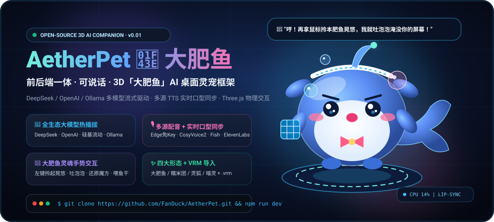
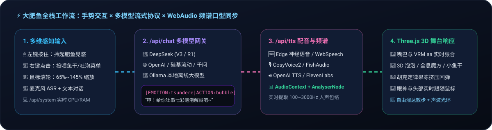
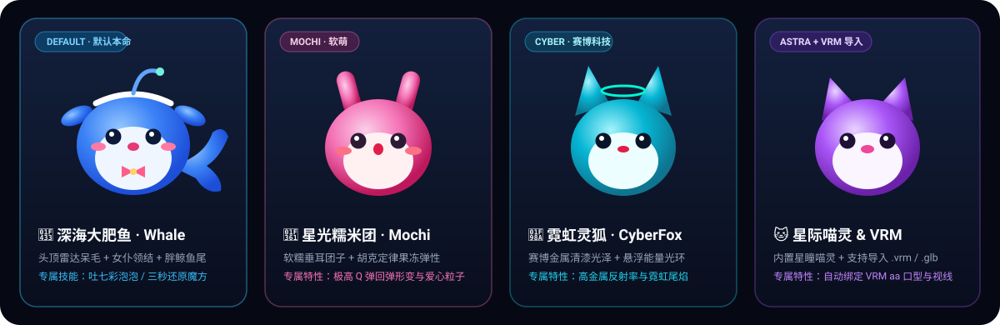

<div align="center">



<br />

# 🐳 AetherPet · 大肥鱼 (艾瑟灵宠)

**前后端一体 · 可说话 · 3D「大肥鱼」AI 桌面宠物与数字伴侣开源框架**  
*Multi-LLM (DeepSeek / OpenAI / Ollama) × Multi-TTS Lip-Sync × Three.js / VRM Interactive Stage*

<p align="center">
  <a href="https://github.com/FanDuck/AetherPet/releases/tag/v0.01"></a>
  <a href="./LICENSE"></a>
  <a href="https://nextjs.org/"></a>
  <a href="https://threejs.org/"></a>
  <a href="https://platform.deepseek.com/"></a>
</p>

<p align="center">
  <a href="#-核心视觉与四大形态展示">🎨 视觉图鉴</a> •
  <a href="#-大肥鱼灵魂手势与-3d-交互矩阵">🐳 大肥鱼交互</a> •
  <a href="#-全生态大模型与配音引擎支持">🧠 大模型与配音</a> •
  <a href="#-30-秒极速启动-quick-start">🚀 极速启动</a> •
  <a href="#-二次开发与扩展指南">🛠️ 扩展指南</a>
</p>

</div>

---

## 🌟 为什么选择 AetherPet？

**AetherPet** 是一个**前后端一体、零配置开箱即用**的 3D AI 宠物开源底座。它将爆火的 **「DeepSeek 大肥鱼（鲸鱼娘）」傲娇活人感交互** 升级到了 **WebGL / Three.js 实时 3D 物理空间**——无需繁琐的 Python 环境配置，只需 `npm run dev` 一条命令，即可拥有一只**能被鼠标拎起来晃悠、会吐七彩泡泡、三秒还原全息魔方、吃小鱼干、监控电脑 CPU/内存、且支持实时声波口型同步说话**的 3D AI 灵宠。

<div align="center">
  
</div>

---

## 🎨 核心视觉与四大形态展示

内置 **4 种程序化高表现力 3D 萌宠形态**（无需下载数兆外部模型即可秒开运行，自带胡克定律果冻弹性物理）+ **6 套星云深海舞台配色**，并原生支持直接拖入本地 **`.vrm` / `.glb` / `.gltf`** 模型！

<div align="center">
  
</div>

| 形态 ID | 角色名称 | 3D 视觉特征 | 招牌交互动作 |
| :--- | :--- | :--- | :--- |
| **`chubbywhale`** | **🐳 深海大肥鱼 (默认本命)** | 雾蓝圆滚滚肚皮 + **头顶雷达呆毛** + 女仆发箍蝴蝶结 + **胖鲸鱼双瓣大尾鳍** | 吐七彩深海泡泡、光速还原三阶魔方、啃金黄小鱼干、被拎起扑腾 |
| **`mochi`** | **🍡 星光糯米团 (Mochi)** | 樱粉软糯垂耳团子 + 高清漆果冻光泽 | 极高 Q 弹挤压回弹 (Squash & Stretch)、360° 螺旋蹦跳 |
| **`cyberfox`** | **🦊 霓虹灵狐 (CyberFox)** | 赛博青金属尖耳 + 悬浮霓虹能量光环 + 蓬松大尾 | 赛博律动热舞、高频声波光环共振 |
| **`astracat`** | **🐱 星际喵灵 / VRM 虚拟化身** | 双高光星瞳三角猫耳 / 支持上传任意 **VRoid `.vrm`** 模型 | 自动绑定 VRM `aa` 口型同步、人型头部骨骼鼠标视线追踪 |

---

## 🐳 大肥鱼灵魂手势与 3D 交互矩阵

我们将「大肥鱼」最受喜爱的桌面互动细节完整复刻进了 3D 舞台：

<table>
  <thead>
    <tr>
      <th width="22%">交互操作</th>
      <th width="28%">触发方式</th>
      <th width="50%">3D 物理与情绪反馈效果</th>
    </tr>
  </thead>
  <tbody>
    <tr>
      <td><b>🤏 拎起晃悠 (Pick &amp; Drag)</b></td>
      <td>按住<b>鼠标左键</b>在屏幕任意拖拽</td>
      <td>大肥鱼被揪住后脖颈拎在半空，身体与呆毛根据拖拽加速度产生<b>真实单摆物理倾斜</b>，小鱼鳍与鲸鱼大尾巴惊慌扑腾，松手后“噗通”Q弹落地。</td>
    </tr>
    <tr>
      <td><b>🍕 右键秘密轮盘</b></td>
      <td>在宠物或舞台上<b>点击鼠标右键</b></td>
      <td>呼出深海玻璃态快捷菜单：一键<b>投喂小鱼干</b>、<b>咕噜吐泡泡</b>、<b>三秒还原魔方</b>、<b>揉头顶呆毛</b>、<b>打瞌睡吹鼻涕泡</b>。</td>
    </tr>
    <tr>
      <td><b>🎡 肥鱼体型缩放</b></td>
      <td>滚动<b>鼠标滚轮</b>（或右键菜单调节）</td>
      <td>在 <code>65% ~ 145%</code> 范围内无级平滑缩放，随心切换“迷你口袋鱼”或“霸屏超大肥鱼”。</td>
    </tr>
    <tr>
      <td><b>🫧 3D 道具与自主溜达</b></td>
      <td>空闲自动触发 / 右侧快捷栏点击</td>
      <td>嘴巴嘟圆吐出上浮的<b>半透明七彩泡泡</b>；双鳍抱起<b>全息三阶魔方</b>飞速旋转；抱起<b>金黄小鱼干</b>大口咀嚼；开启「自由溜达」后自主迈着八字步散步。</td>
    </tr>
    <tr>
      <td><b>💻 硬件算力监控</b></td>
      <td>左上角状态栏实时轮询 <code>/api/system</code></td>
      <td>实时显示本机 <b>CPU 占用率</b>与 <b>RAM 内存使用量 (GB/%)</b>，高负载时自动变色提醒主人休息。</td>
    </tr>
  </tbody>
</table>

---

## 🧠 全生态大模型与配音引擎支持

点击网页右上角 **「引擎配置」** 即可可视化热插拔切换所有主流大模型与 TTS 配音 API（配置自动持久化保存在本地）：

### 1. 大语言模型网关 (`/api/chat`)

| 服务商 Preset | 默认 Base URL | 推荐模型 | 特色说明 |
| :--- | :--- | :--- | :--- |
| **DeepSeek (深度求索)** | `https://api.deepseek.com/v1` | `deepseek-chat` / `deepseek-reasoner` | **大肥鱼本命大脑**，傲娇斗嘴与代码解答性价比之王 |
| **OpenAI** | `https://api.openai.com/v1` | `gpt-4o-mini` / `gpt-4o` | 全球标准接口，响应极速 |
| **SiliconFlow (硅基流动)** | `https://api.siliconflow.cn/v1` | `deepseek-ai/DeepSeek-V3` / `Qwen2.5` | **一个 API Key 同时搞定大模型对话 + CosyVoice2 配音** |
| **通义千问 / 智谱 GLM** | 阿里云 DashScope / BigModel | `qwen-plus` / `glm-4-flash` | 国内低延迟直连，`glm-4-flash` 免费可用 |
| **Ollama (本地离线)** | `http://localhost:11434/v1` | `qwen2.5:7b` / `deepseek-r1:8b` | **100% 免费离线私有部署**，无需任何 API Key |
| **内置免 Key 智能模式** | 本地内置流式引擎 | `built-in-chubbywhale` | **零配置兜底**：哪怕刚 Clone 下来没填任何 Key，也能流式对话并触发全套动作 |

### 2. 多源配音与实时口型同步 (`/api/tts` + `VoiceEngine`)

| 配音引擎 Preset | 是否需要 Key | 代表声线 / 模型 | 口型同步驱动方式 |
| :--- | :---: | :--- | :--- |
| **Edge 神经云配音** | ❌ **免 Key** | `zh-CN-XiaoyiNeural` (元气傲娇少女) | 音频流 + WebAudio 实时频谱 + 自动回退兜底 |
| **Web Speech 原生语音** | ❌ **免 Key** | 系统内置中文/日语/英语甜美声线 | 零延迟离线发音 + 拟真双正弦声波口型包络 |
| **SiliconFlow 语音** | 🔑 需 Key | `FunAudioLLM/CosyVoice2-0.5B:anna` | MP3 音频流 + `AnalyserNode` 100~3000Hz 频谱口型同步 |
| **OpenAI Audio TTS** | 🔑 需 Key | `tts-1` (`nova` / `shimmer` / `alloy`) | MP3 音频流 + `AnalyserNode` 实时频谱口型同步 |
| **Fish Audio / ElevenLabs** | 🔑 需 Key | 社区任意二次元角色 Reference ID / 多语言声线 | MP3 音频流 + `AnalyserNode` 实时频谱口型同步 |
| **本地 GPT-SoVITS** | ❌ 本地服务 | `http://localhost:9880/v1` | 完美对接本地声音克隆服务并驱动 3D 口型 |

---

## 🚀 30 秒极速启动 (Quick Start)

### 1. 克隆仓库并安装依赖

```bash
git clone https://github.com/FanDuck/AetherPet.git
cd AetherPet
npm install --legacy-peer-deps
```

### 2. 一键启动前后端一体服务

```bash
npm run dev
```

打开浏览器访问 **[http://localhost:3000](http://localhost:3000)**，你的 3D 大肥鱼已经在舞台上摇着尾巴等你啦！

### 3. 配置环境变量（可选）

你既可以直接在网页右上角 **「引擎配置」** 弹窗中填入 API Key，也可以复制 `.env.example` 为 `.env.local` 配置服务端默认密钥：

```bash
cp .env.example .env.local
```

```env
LLM_API_KEY=sk-your-deepseek-or-openai-key
LLM_BASE_URL=https://api.deepseek.com/v1
LLM_MODEL=deepseek-chat
```

---

## 🎭 大模型情绪与 3D 动作协同协议

AetherPet 通过轻量级标签协议让大模型直接接管 3D 宠物的表情肌肉与骨骼动作。每次大模型回复开头会自动携带：

```text
[EMOTION:tsundere|ACTION:bubble] 哼！看在你今天这么认真写代码的份上，本大肥鱼就给你吐几个幸运泡泡解闷吧！
```

- **支持的 10 种情绪 (`EMOTION`)**：`tsundere` (傲娇挑眉) · `happy` (开心) · `excited` (星星眼) · `curious` (歪头好奇) · `shy` (害羞脸红) · `sleepy` (困倦吹泡) · `thinking` (思考光环加速) · `sad` (委屈八字眉) · `love` (冒爱心) · `dizzy` (拎起晃晕)
- **支持的 13 种 3D 动作 (`ACTION`)**：`bubble` (吐七彩泡泡) · `cube` (还原全息魔方) · `eat` (吃金黄小鱼干) · `wander` (企鹅步溜达) · `dragged` (半空扑腾) · `sleep` (打瞌睡吹鼻涕泡) · `jump` (蹦跳) · `spin` (360°大回旋) · `wave` (挥动鱼鳍) · `nod` (点头) · `dance` (甩尾跳舞) · `shake` (晃脑) · `idle` (呼吸待机)

---

## 📂 项目工程结构

```text
AetherPet/
├── public/
│   └── assets/                       # 仓库高清动态 SVG 视觉海报与架构图鉴
│       ├── hero-banner.svg           # 顶部 3D 大肥鱼动态悬浮主视觉海报
│       ├── species-showcase.svg      # 四大萌宠形态 + VRM 导入视觉图鉴
│       └── interaction-guide.svg     # 全栈交互与声波口型同步流水线图
├── src/
│   ├── app/
│   │   ├── api/
│   │   │   ├── chat/route.ts         # 多模型 SSE 流式对话网关 (DeepSeek/OpenAI/Ollama等)
│   │   │   ├── tts/route.ts          # 多源配音合成网关 (Edge/CosyVoice2/OpenAI/FishAudio/ElevenLabs)
│   │   │   └── system/route.ts       # 本机 CPU 与 RAM 内存实时硬件监控接口
│   │   ├── globals.css               # 全局样式与隐藏滚动条工具类
│   │   ├── layout.tsx                # 根布局与 메타元数据
│   │   └── page.tsx                  # 全栈一体主舞台视图
│   ├── components/
│   │   ├── canvas/
│   │   │   ├── PetStage.tsx          # Three.js 光影舞台、滚轮缩放、右键拦截与星尘粒子
│   │   │   ├── ProceduralPet.tsx     # 3D 大肥鱼核心实现 (拖拽惯性/呆毛/泡泡/魔方/小鱼干/口型)
│   │   │   └── CustomModelPet.tsx    # 外部 .vrm / .glb 模型加载与 aa 口型骨骼驱动器
│   │   └── ui/
│   │       ├── PetHUD.tsx            # 悬浮 HUD、四维状态条、CPU监控、右键轮盘菜单与语音对讲
│   │       └── SettingsModal.tsx     # 大模型、配音 API、3D 形态与傲娇人设配置中心
│   ├── lib/
│   │   ├── presets.ts                # 服务商预设清单、6 套星云配色与大肥鱼傲娇 System Prompt
│   │   ├── emotionParser.ts          # [EMOTION|ACTION] 协议解析器
│   │   └── voiceEngine.ts            # WebAudio 频谱分析器与实时口型包络计算引擎
│   ├── store/
│   │   └── usePetStore.ts            # Zustand 全局持久化状态管理
│   └── types/
│       └── pet.ts                    # TypeScript 核心类型定义
├── .env.example                      # 环境变量配置模板
├── LICENSE                           # MIT 开源许可证
└── package.json
```

---

## 📄 开源协议 (License)

本项目基于 **[MIT License](./LICENSE)** 开源。如果你喜欢这只傲娇的 3D 大肥鱼，欢迎点亮右上角的 **⭐ Star** 支持我们！
